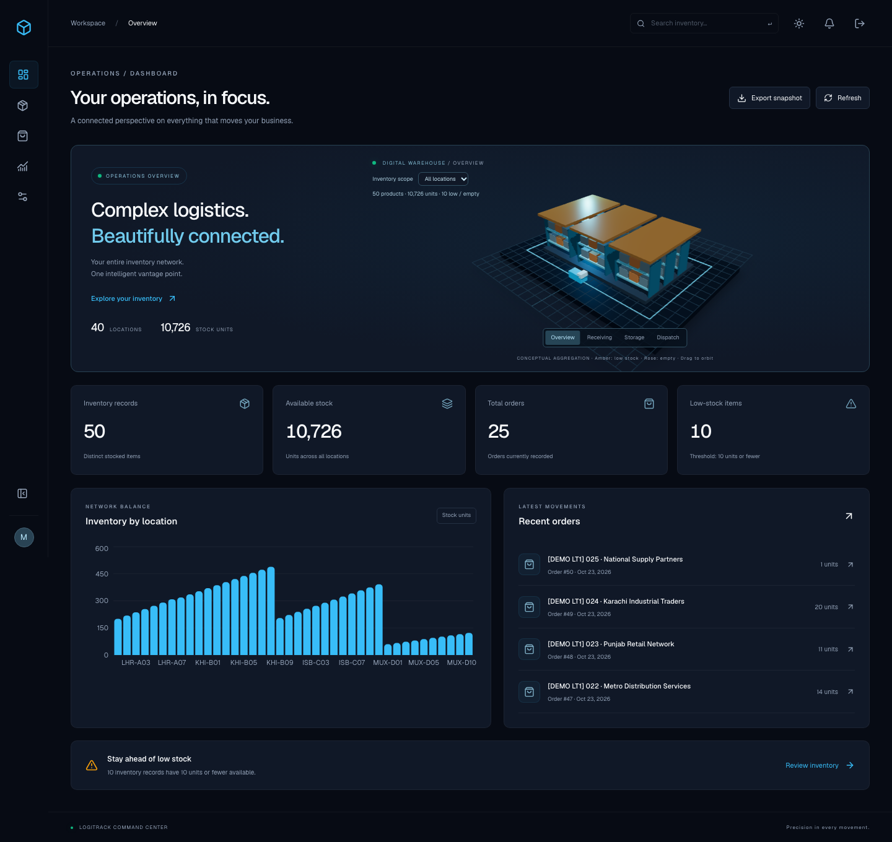
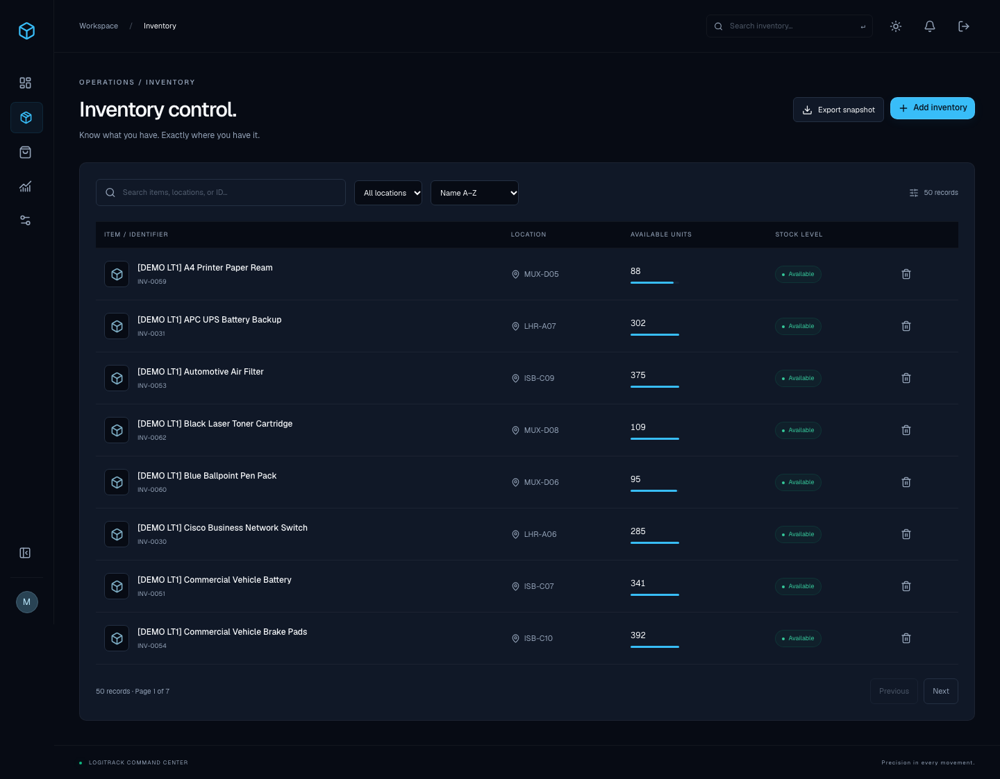
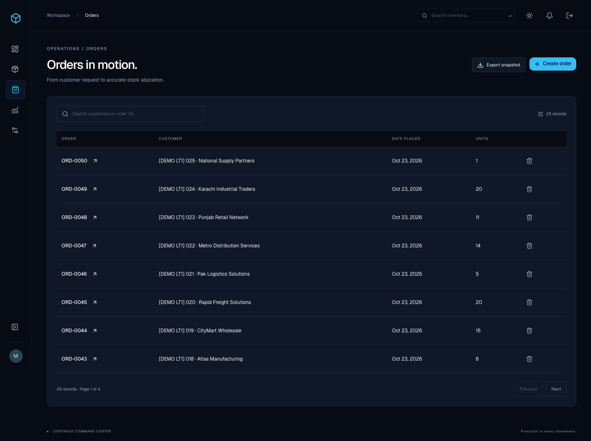
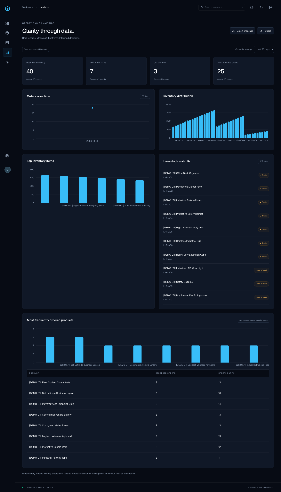
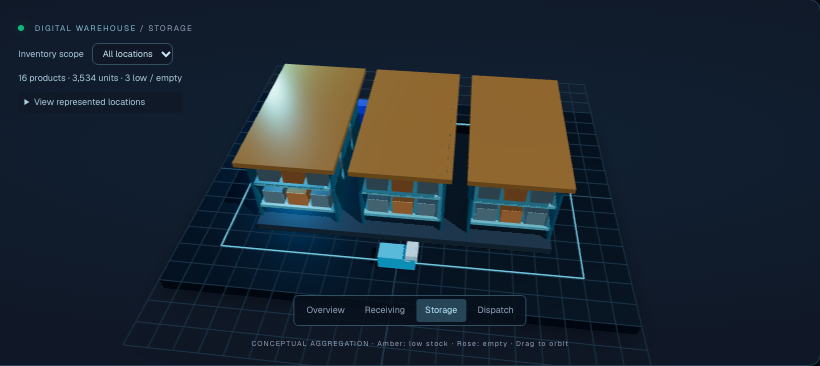

<div align="center">

# LogiTrack

**Full-Stack Logistics, Inventory & Order Management System**

Inventory visibility. Transactional order control. A connected operations workspace.


[Application preview](#application-preview) · [Features](#features) · [Architecture](#architecture) · [Run locally](#run-locally) · [API](#api-reference) · [Testing](#testing)

</div>

LogiTrack brings product availability, warehouse locations and customer orders into one interface. An ASP.NET Core API enforces inventory rules and permissions; a Next.js command center turns the persisted records into searchable tables, charts and a conceptual 3D warehouse.

The project demonstrates full-stack engineering through a real authentication boundary, transactional stock allocation, relational persistence, typed API integration and accessible alternatives to its visual experience. It is a local-development application and a practical foundation for inventory-heavy workflows at warehouses, distributors and small businesses.

## Application Preview

The following images are genuine browser captures of the running application using its synthetic demo catalog. They contain no live customer data. All views use the same **1440 × 900 desktop viewport**; full-page captures show content beyond the fold, and the warehouse image is a direct panel capture. The sidebar is collapsed to keep account details private.

### Operations dashboard

Real inventory counts, available units, recorded orders, low-stock alerts, location distribution and recent order activity.



<details>
<summary><strong>Inventory management</strong> — product availability and warehouse locations</summary>

Search products, filter locations, sort records and review stock levels. Managers can create inventory and confirm eligible deletions.



</details>

<details>
<summary><strong>Order management</strong> — customer orders and allocated quantities</summary>

Browse recorded orders and inspect their product lines. Creating an order allocates stock; deleting an order restores it.



</details>

<details>
<summary><strong>Analytics</strong> — stock distribution and recorded-order insights</summary>

Inspect availability, low/empty stock, daily order counts and frequently ordered products, all derived from saved records.



</details>

<details>
<summary><strong>Interactive 3D warehouse</strong> — a conceptual view of inventory</summary>

Procedural racks, packages, lighting and a moving vehicle provide a visual overview. City scopes and rack summaries use real inventory data; the geometry and routes are illustrative, not a physical warehouse map or live shipment tracker.



</details>

## Features

| Area | Implemented capabilities |
|---|---|
| **Authentication & access** | Registration, login, Identity password checks, JWT validation, protected pages and Manager-only writes |
| **Inventory** | Listing, search, location filtering, name/quantity sorting, client-side pagination, record details, creation and confirmed deletion |
| **Orders** | Listing, details, one or more product lines, availability checks, creation and confirmed deletion |
| **Stock integrity** | Duplicate-line aggregation, conditional SQL deductions, transaction rollback, stock restoration and referenced-item protection |
| **Dashboard** | API-derived KPIs, location chart, recent orders, low-stock summary, refresh and JSON snapshot export |
| **Analytics** | Location distribution, top stock items, availability counts, daily surviving-order trends and product order frequency |
| **Experience** | Responsive navigation, light/dark themes, persistent device preferences, validation, loading/empty/error states and accessible dialogs |
| **3D visualization** | React Three Fiber scene, pointer/orbit controls, zone camera transitions, stock-based highlights, city summaries and reduced-motion fallback |
| **Developer tooling** | OpenAPI/Swagger in Development, HTTP integration tests, stock-concurrency tests, Playwright workflows and resumable demo generation |

### How stock moves

1. A Manager creates an order with valid product IDs and positive quantities.
2. The API combines repeated product lines and conditionally deducts each requested quantity inside one database transaction.
3. Missing products or insufficient stock reject the order and roll back earlier deductions.
4. The order and its lines commit together with the allocation.
5. Deleting the order restores its quantities transactionally. An inventory product referenced by an existing order cannot be deleted.

Low stock means **10 units or fewer**, including zero. There is no PUT/PATCH editing, shipment status, payment workflow or invented revenue metric.

## Architecture

```text
Next.js frontend
  Server layouts + interactive React components
          │ same-origin requests
          ▼
Next.js API gateway (/api/gateway/*)
  HttpOnly session cookie → server-side Bearer header
          │ authenticated REST requests
          ▼
ASP.NET Core 10 API
  Controllers · DTO validation · Identity · Manager authorization
          │ asynchronous queries and transactions
          ▼
Entity Framework Core 10
  LogiTrackContext · entity relationships · migrations
          │
          ▼
SQLite
  Inventory · orders · order lines · Identity users and roles
```

- **Frontend:** React state/effects manage records, forms, filters, dialogs and loading/error state. Context shares account information. Successful mutations reload the API lists. Only appearance/motion preferences use localStorage.
- **Gateway:** The browser signs in through the existing backend via a same-origin route handler. The JWT is stored in an HttpOnly, SameSite=Strict cookie, with Secure enabled in production. Allowed requests forward it server-side; mutation requests require a matching Origin. Business-data requests use `no-store`.
- **Backend:** The API validates JWT signatures, issuer, audience, algorithm and lifetime, then enforces role permissions. Controllers implement the stock-allocation rules. New registrations do not receive Manager access.
- **Persistence:** `LogiTrackContext` inherits from `IdentityDbContext<ApplicationUser>`. `OrderItem` joins orders and products with a composite order/product key. Foreign keys protect inventory references and cascade order-line deletion.

The frontend decodes claims for presentation; the API remains the authoritative authentication/authorization boundary. There are no external microservices, Redis cache or real-time synchronization service. Inventory reads are fresh: memory-cache infrastructure is registered, but no populated application business-data cache is active.

## Technology Stack

| Layer | Verified project technology |
|---|---|
| API | ASP.NET Core 10, C# 14, .NET 10 target |
| Persistence & accounts | EF Core / Identity / JWT bearer packages 10.0.13, SQLite |
| API exploration | Swashbuckle.AspNetCore 10.3.1 |
| Web application | Next.js 16.4.2 App Router, React 19.3.0, TypeScript 5.9.3 |
| UI | Tailwind CSS 4.3.3, shadcn Nova / Base UI, Geist, Lucide |
| Visualization | Recharts 3, Three.js 0.182.0, React Three Fiber 9, Drei 10 |
| Tests | Python standard-library integration tests, Playwright 1.64.1 |

Package manifests and `frontend/package-lock.json` define the installable versions. There is no hosted application or deployment pipeline claimed by this repository.

## Run Locally

### Prerequisites

The supported setup documented here is **macOS on Apple Silicon**. Other operating systems have not been verified for this project's shell scripts and test workflow.

| Requirement | Version / purpose |
|---|---|
| .NET SDK | **10.x**; verified with 10.0.402 |
| Node.js | **24+** for the current macOS dependency graph; verified with 26.10.0. Some dependencies require newer Node than Next.js's own minimum. |
| npm | Included with Node; verified with 11.19.1 |
| Python | **3.9+**; verified with 3.9.6. Seeding/tests use the standard library. |
| Git | Required to clone; verified with 2.54.0 |

Check your tools:

```bash
dotnet --version
node --version
npm --version
python3 --version
git --version
```

### 1. Clone and install dependencies

```bash
git clone https://github.com/Alibhatti514/LogiTrack-FullStack-Logistics-Management-System.git
cd LogiTrack-FullStack-Logistics-Management-System

dotnet restore backend/LogiTrack.csproj
(cd frontend && npm ci)
```

The repository does **not** include a database, local `.env`, Manager password or access token.

### 2. Initialize and start the backend

Check that port 5187 is free, then run from the repository root:

```bash
bash scripts/run-mac.sh
```

On a fresh clone, this existing launcher:

1. Creates root `.env` **only if it is absent**, generating a random signing key and bootstrap Manager password with restrictive file permissions.
2. Loads that local environment, enters `backend/` and starts the API in Development.
3. Lets application startup create the local SQLite database, apply the committed EF migrations and provision the configured Manager.

Existing environment files and databases are retained. Open your generated `.env` privately in a local editor to obtain the Manager login; do not paste it into issues, commits or screenshots. No separate EF CLI installation is needed for this startup path.

### 3. Start the frontend

In a second terminal, from the cloned directory:

```bash
cd frontend
npm run dev
```

| Service | Local address |
|---|---|
| Application | [http://localhost:3000](http://localhost:3000) |
| API health | [http://127.0.0.1:5187/health](http://127.0.0.1:5187/health) |
| Development Swagger | [http://127.0.0.1:5187/swagger](http://127.0.0.1:5187/swagger) |

Use the same browser origin consistently. The frontend defaults to this API address, so a frontend environment file is not required for local setup.

Once both ports are free, `bash scripts/dev-all.sh` is an alternative launcher for both services. Do not run it alongside already-running copies. `scripts/setup-mac.sh` is an optional EF-oriented helper: it can install the EF tool, restores/builds and applies database updates. It is not needed before `run-mac.sh` and is not a read-only check.

### Environment configuration

Automatic local setup is the simplest path. For custom setup, `.env.example` documents the backend variables with empty placeholders. Copy it only when you intend to supply your own values **before** starting the backend; blank placeholders will not start a working authenticated application. Do not overwrite an existing `.env`.

| Variable | Scope | Purpose |
|---|---|---|
| `Jwt__Key` | Backend / root `.env` | Required secret of at least 32 bytes |
| `Bootstrap__ManagerEmail` | Backend / root `.env` | Optional bootstrap account email; needed with its password to provision a Manager |
| `Bootstrap__ManagerPassword` | Backend / root `.env` | Private bootstrap password satisfying Identity policy; never browser-exposed |
| `ConnectionStrings__DefaultConnection` | Backend environment | Optional SQLite override; use an **absolute** path for test databases |
| `API_URL` | Frontend server environment | Preferred server-only API origin override |
| `NEXT_PUBLIC_API_URL` | Frontend environment | Existing non-secret API-origin fallback; never use public variables for credentials |
| `LOGITRACK_URL` | Python scripts | Optional HTTP API target override |

The gateway resolves `API_URL` → `NEXT_PUBLIC_API_URL` → `http://127.0.0.1:5187`. To use another API origin, create a local `frontend/.env.local` containing `API_URL=your_api_origin`, without replacing an existing file, then restart Next.js. A root `.env` is loaded by the backend launcher, not automatically by Next.js in `frontend/`.

The default database remains root `logitrack.db`. Relative SQLite sources are resolved against the repository root even though the backend project is in `backend/`; absolute overrides remain absolute. Migrations are applied during startup. For an intentional manual EF update, use the existing EF helper or the matching `dotnet-ef` tool with `--project backend/LogiTrack.csproj --startup-project backend/LogiTrack.csproj`. Do not add/reset migrations just to start a fresh clone.

## Demo Data

After starting the backend, run from the repository root:

```bash
python3 scripts/seed-demo.py
```

The script authenticates with the existing Manager configuration from your environment or root `.env`, then writes through the real API. It does not bypass stock deduction or validation.

| Catalog | Initial demo data |
|---|---|
| Products | 50: Electronics (10); Warehouse Equipment, Packaging Materials, Automotive Supplies, Office Supplies and Industrial Equipment (8 each) |
| Locations | 40: LHR-A01–A10, KHI-B01–B10, ISB-C01–C10 and MUX-D01–D10 |
| Orders | 25 fictional business orders, one to four product lines each |
| Available stock | 10,726 units after the seeded orders |
| Distribution | 30 healthy, 10 medium, 7 low and 3 empty products |
| Identification | Reserved `[DEMO LT1]` product and order markers |

Location prefixes represent Lahore, Karachi, Islamabad and Multan. Categories are catalog metadata, not an added database field. The dashboard's ≤10 threshold counts the seven low and three empty products together. Orders use their actual creation timestamps; daily charts initially show activity on the import date. Later business activity can change these totals.

Verify existing demo records without creating missing business records:

```bash
python3 scripts/seed-demo.py --verify-only
```

Normal reruns skip existing records and do not reset stock. The importer uses an atomic local manifest and process lock under ignored `.local/`. Keep that state with its matching database backup. `--verify-only` still authenticates and updates manifest reconciliation information.

If a POST committed but its response was lost, a rerun can reconcile its reserved marker. Ambiguous pending requests without a matching record, missing confirmed records, changed order lines or duplicate markers stop for review. Do not delete the manifest to reset the catalog or run parallel seeders from separate checkouts: the lock is local, and the API does not offer global idempotency keys.

## API Reference

Direct authenticated API clients send `Authorization: Bearer <your-local-access-token>`. The browser handles this through the gateway; never put real tokens into documentation. Swagger is available only in Development, and a Swagger Bearer **Authorize** integration is not configured.

| Method | Endpoint | Access | Purpose |
|---|---|---|---|
| GET | `/health` | Public | Service health |
| POST | `/api/auth/register` | Public | Create an ordinary account |
| POST | `/api/auth/login` | Public | Verify credentials and issue a one-hour JWT |
| GET | `/api/inventory` | Authenticated | List current inventory |
| POST | `/api/inventory` | Manager | Create an inventory record |
| DELETE | `/api/inventory/{id}` | Manager | Delete an unreferenced inventory record |
| GET | `/api/orders` | Authenticated | List recorded orders |
| GET | `/api/orders/{id}` | Authenticated | Retrieve an order and its product lines |
| GET | `/api/orders/analytics` | Authenticated | Rank eight products by order count, then ordered units |
| POST | `/api/orders` | Manager | Create an order and allocate stock |
| DELETE | `/api/orders/{id}` | Manager | Remove an order and restore stock |

Inventory requests contain `name`, nonnegative integer `quantity` and `location`; name/location are limited to 120 characters. Order requests contain `customerName` and an `items` array of positive `inventoryItemId` / `quantity` values. Common responses include 400 for invalid input, 401 for missing/invalid authentication, 403 for insufficient role permissions, 404 for missing records and 409 for stock/reference conflicts.

Read-only health/access checks:

```bash
curl --fail --silent --show-error http://127.0.0.1:5187/health
curl --silent --output /dev/null --write-out 'HTTP %{http_code}\n' \
  http://127.0.0.1:5187/api/inventory
# The anonymous inventory request should return HTTP 401.
```

## Testing

### Build, static checks and dependency checks

From the repository root:

```bash
dotnet build backend/LogiTrack.csproj
dotnet list backend/LogiTrack.csproj package --vulnerable --include-transitive
python3 scripts/test-seed-demo.py
```

From `frontend/`:

```bash
npm run lint
npx --no-install tsc --noEmit --incremental false
npm run build
npm audit
npm audit --omit=dev
```

Builds/static checks do not create business records, but write generated output. `test-seed-demo.py` uses a fake API and temporary state; it does not touch the development database. Dependency audits are read-only checks and may exit nonzero when advisories are present.

### HTTP integration and concurrency tests

`scripts/test-api.py` covers registration/login, anonymous and role restrictions, validation, inventory/order creation, allocation, reference protection, deletion and restoration. `scripts/test-stock.py` adds duplicate-line aggregation, rollback, competing allocations and concurrent-deletion checks.

**These tests write data. Use an isolated API/database.** The API test also leaves its newly registered user in the selected database. The following optional block uses a temporary absolute SQLite path and a separate port; it does not reset the normal development database. Run after the backend has been built and root `.env` exists:

<details>
<summary>Run API tests against an isolated SQLite database</summary>

```bash
# Run from the repository root.
bash <<'SH'
set -euo pipefail
if lsof -nP -iTCP:5199 -sTCP:LISTEN >/dev/null 2>&1; then
  echo 'Port 5199 is occupied; no test server started.'
  exit 1
fi
test -f .env
set -a
source .env
set +a
logitrack_test_dir=$(mktemp -d "${TMPDIR:-/tmp/}logitrack-tests.XXXXXX")
ConnectionStrings__DefaultConnection="Data Source=$logitrack_test_dir/test.db" \
ASPNETCORE_ENVIRONMENT=Development \
dotnet run --no-build --project backend/LogiTrack.csproj \
  --no-launch-profile --urls http://127.0.0.1:5199 \
  >"$logitrack_test_dir/server.log" 2>&1 &
logitrack_test_pid=$!
trap 'kill "$logitrack_test_pid" 2>/dev/null || true; wait "$logitrack_test_pid" 2>/dev/null || true' EXIT
ready=0
for attempt in $(seq 1 60); do
  if curl --fail --silent http://127.0.0.1:5199/health >/dev/null; then
    ready=1
    break
  fi
  sleep 0.5
done
if [ "$ready" -ne 1 ]; then
  echo "Test API did not start; inspect $logitrack_test_dir/server.log privately."
  exit 1
fi
LOGITRACK_URL=http://127.0.0.1:5199 python3 scripts/test-api.py
LOGITRACK_URL=http://127.0.0.1:5199 python3 scripts/test-stock.py
echo "Isolated database and log retained at $logitrack_test_dir"
SH
```

</details>

### Browser tests

Playwright tests cover authentication, Manager inventory/order workflows, viewer restrictions, API failures, mobile navigation, persistent themes, dashboard KPIs and warehouse/analytics data. Use a **disposable checkout with its own database and environment**. The registration teardown opens `../logitrack.db` directly, so changing only `API_URL` is not enough to isolate the full suite.

In that disposable checkout, start its backend and seed its demo catalog. Ensure port 3000 is free or belongs to that checkout. Then:

```bash
cd frontend
# One-time browser setup if Chromium is not already installed:
npx --no-install playwright install chromium
npx --no-install playwright test
```

Playwright reuses a server at its configured URL or starts the frontend. The demo browser test expects 50 marked products and 25 marked orders. Do not run write-capable browser tests against an important development database.

## Security & Current Boundaries

**Implemented controls:** ASP.NET Core Identity password hashing and lockout; bounded authentication inputs; HS256 JWT signature/issuer/audience/lifetime validation; authenticated reads and Manager-only mutations; DTO validation; parameterized EF Core access; transactional stock changes; HttpOnly/SameSite cookies; same-Origin gateway mutation checks; restricted forwarding paths, request timeout and disabled redirects; generic unexpected-error JSON.

**Current limits:** logout removes this browser's cookie but does not revoke issued JWTs. There is no refresh-token service, rate limiter, MFA, password recovery, email-verification workflow or CSP. Startup migrations/bootstrap need a controlled production lifecycle. HTTPS redirection/HSTS are configured outside Development, but no hosted TLS deployment is claimed.

Tables currently paginate/filter client-side and list APIs return full datasets. Deleted orders are not retained in an immutable history. Other users' updates require refresh/navigation. Profile editing and a notification feed are not implemented; the UI identifies those limits.

The last dependency checks reported no vulnerable NuGet packages and no production npm dependency findings. The full npm audit reports **nine high development-tooling findings** associated with `braces` through ESLint/shadcn chains ([GHSA-vfj7-8cjw-p6xm](https://github.com/advisories/GHSA-vfj7-8cjw-p6xm)). These findings remain unresolved. No claim of complete production hardening, a clean full audit or CI/CD validation is made. Avoid forced dependency downgrades merely to silence an audit.

Keep `.env`, SQLite files, seed state, logs and test artifacts private. `.gitignore` permits only the five intended documentation screenshots while continuing to exclude unrelated captures and private artifacts.

## Project Structure

```text
LogiTrack-FullStack-Logistics-Management-System/
├── backend/                  # ASP.NET Core API, Identity/JWT, EF context and migrations
│   ├── Controllers/
│   ├── DTOs/
│   ├── Data/
│   ├── Models/
│   ├── Services/
│   ├── Migrations/
│   ├── Properties/
│   ├── Program.cs
│   ├── appsettings.json
│   └── LogiTrack.csproj
├── frontend/                 # Next.js application, UI, charts, 3D scene and browser tests
│   ├── src/{app,components,lib}/
│   ├── public/
│   ├── tests/
│   ├── package.json
│   └── package-lock.json
├── scripts/                  # Local launchers, API tests and demo-data generator
├── docs/screenshots/         # Genuine application captures used in this README
├── .env.example              # Empty backend configuration placeholders
├── .gitignore
└── README.md
```

The database and local environment are created on your machine; they are not public repository assets.

## Author

**Developed by Ali Bhatti**<br>
Full Stack Web Developer

[Portfolio](https://ali-bhatti-portfolio.vercel.app/) · [GitHub](https://github.com/Alibhatti514) · [Project repository](https://github.com/Alibhatti514/LogiTrack-FullStack-Logistics-Management-System)
